# 🔎 AI Reverse User Story Creation: Document Business Rules from Source Code with a Local LLM


### Reverse-Engineer a Repository into User Stories, Business Rules and Flows, with Evidence for Every Rule

**AI Reverse User Story Creation** reads a code repository, identifies how its **business rules** work and documents them as **user stories, acceptance criteria and flow diagrams**. It runs on a **local LLM (Ollama)**, so the code never leaves your machine, and **every rule must cite the files and lines that prove it**. Rules without evidence are rejected, and the citations are checked against the repository.

It is useful when a system has code but no documentation: legacy applications, inherited projects, or any repository where QA needs to understand what the software is supposed to do before writing tests.

> **Status:** 🚧 In development. The repository scanner, the data models and the evidence verification are in place and tested. The model integration and the documentation writer are next. Features are marked ✅ available, 🚧 in progress or 💡 planned.

> **Responsible use:** run the tool only on repositories you are allowed to analyze. Processing is local, and the scanner skips common secret files by name, but that filter is not a guarantee. Review the output before sharing it.

---

## 🗺️ Quick Navigation

* [Where It Fits](#-where-it-fits)
* [How It Works](#-how-it-works)
* [Output Format](#-output-format)
* [Capabilities](#-capabilities)
* [Getting Started](#-getting-started)
* [Design Goals](#-design-goals)
* [Tech Stack](#%EF%B8%8F-tech-stack)
* [Roadmap](#%EF%B8%8F-roadmap)
* [Related Projects](#-related-projects)

---

## 🧭 Where It Fits

```mermaid
flowchart LR
    REPO["Source Code Repository<br/>any language"] --> REV["AI Reverse User Story Creation<br/>this repository"]
    REV -->|"User stories, business rules<br/>and acceptance criteria"| GEN["AI Test Case Generator<br/>RAG and Ollama"]
    GEN --> TS["Test Suites<br/>Cypress, Playwright,<br/>Selenium, API"]
    TS --> CI["CI/CD Pipeline<br/>Jenkins, Docker, SonarQube"]
    REV -->|"Markdown docs<br/>and Mermaid flows"| DOCS["Business Rule<br/>Documentation"]

    style REV fill:#1f2d3d,stroke:#38bdf8,stroke-width:2px
```



The output can be sent straight to the [AI Test Case Generator](https://github.com/acorvello/ai-test-case-generator): each feature exports a request body with `title`, `user_story` and `acceptance_criteria`.

---

## 🔄 How It Works

```mermaid
flowchart LR
    A["Scan Repository<br/>ignore, size and secret filters"] --> B["Group by Module<br/>directories and entry points"]
    B --> C["Extract with Local LLM<br/>Ollama"]
    C --> D["Validate Structure<br/>Pydantic"]
    D --> E["Verify Evidence<br/>files and line ranges"]
    E --> F["Write Documentation<br/>Markdown, Mermaid, JSON"]
    E -.->|"rejected rules"| C

    style A fill:#1f2d3d,stroke:#38bdf8,stroke-width:2px
    style D fill:#1f2d3d,stroke:#38bdf8,stroke-width:2px
    style E fill:#1f2d3d,stroke:#38bdf8,stroke-width:2px
    style B fill:#111827,stroke:#10b981,stroke-width:1px,stroke-dasharray: 5 5
    style C fill:#111827,stroke:#10b981,stroke-width:1px,stroke-dasharray: 5 5
    style F fill:#111827,stroke:#10b981,stroke-width:1px,stroke-dasharray: 5 5
```



Highlighted steps are implemented. Dashed steps are planned.

1. **Scan:** lists source files, skipping dependency and build folders, large files, symbolic links and common secret files.
2. **Group by module:** gathers related files so the model sees a complete flow, not isolated snippets.
3. **Extract:** a local model proposes features, user stories and business rules.
4. **Validate:** the answer must match a strict schema.
5. **Verify evidence:** each cited file must exist and each line range must be inside the file. Rules that fail are sent back for another attempt or reported.
6. **Write documentation:** Markdown pages, Mermaid flow diagrams and JSON.

---

## 📄 Output Format

Each feature follows this structure. The example below is **illustrative**: file paths and line numbers are placeholders that show the format.

```json
{
  "name": "Apply coupon at checkout",
  "module": "Basket and Orders",
  "user_story": {
    "actor": "a customer at checkout",
    "goal": "to enter a coupon code",
    "benefit": "I get a discount on my order"
  },
  "rules": [
    {
      "statement": "An expired coupon is rejected with an error message.",
      "evidence": [{ "file": "routes/coupon.ts", "start_line": 10, "end_line": 24 }]
    }
  ],
  "open_questions": ["Can coupons be combined?"]
}
```

* **`rules`** is the core of the output. A rule always has at least one piece of evidence.
* **`open_questions`** lists what the code does not settle, so a person can decide instead of the model guessing.
* **Generator export:** `Feature.to_generator_payload()` returns the request body for the AI Test Case Generator:

```json
{
  "title": "Apply coupon at checkout",
  "user_story": "As a customer at checkout, I want to enter a coupon code so that I get a discount on my order.",
  "acceptance_criteria": ["An expired coupon is rejected with an error message."]
}
```

---

## 🎯 Capabilities

| Capability | Description | Status |
| :--- | :--- | :---: |
| **Repository scanner** | Stable file listing with ignore, size, symlink and secret-name filters | 🚧 |
| **Data models** | Features, user stories and rules, where a rule without evidence is rejected | 🚧 |
| **Evidence verification** | Checks that cited files exist and line ranges are valid | 🚧 |
| **Module grouping** | Groups files by module and entry point, for any language | 💡 |
| **Local LLM extraction** | Extracts features and rules with Ollama, with retries on invalid output | 💡 |
| **Documentation writer** | Markdown pages per module and Mermaid flow diagrams | 💡 |
| **Export to the Test Case Generator** | JSON ready for the generator's API | 💡 |
| **Command-line interface** | One command to analyze a repository | 💡 |

---

## 🚀 Getting Started

The project is at the scaffold stage. You can already run the tests.

**Prerequisites:** Python 3.10+.

```powershell
python -m venv .venv
.\.venv\Scripts\Activate.ps1
pip install -r requirements.txt
python -m unittest discover -s tests -v
```

**Linux / macOS:**

```bash
python -m venv .venv
source .venv/bin/activate
pip install -r requirements.txt
python -m unittest discover -s tests -v
```

### Project structure

```text
ai-reverse-user-story-creation/
├── ai_reverse_user_story/
│   ├── models.py        # Feature, UserStory, BusinessRule, Evidence
│   ├── scanner.py       # repository scanner and safe file reading
│   └── verify.py        # evidence verification
├── tests/
├── notebooks/
│   └── 01_prototype_user_story_dataset.ipynb
├── requirements.txt
└── LICENSE
```

### Origin

The project started as a notebook prototype that used Ollama to extract features and user stories from the [OWASP Juice Shop](https://github.com/juice-shop/juice-shop) source code. The prototype is kept in `notebooks/` for reference. It is tied to Juice Shop's folder layout and does not record evidence for each rule, which are the two limitations this repository addresses.

---

## 🧩 Design Goals

* **Evidence first:** no rule without file and line citations, and every citation is verified.
* **Local first:** the model runs on your machine through Ollama, so source code is not sent to external services.
* **Structured output:** answers must match a schema before they are accepted.
* **Humans decide what the code does not say:** gaps become open questions, not guesses.
* **Language-agnostic:** no fixed folder layout. The scanner and the grouping work on any repository.
* **Ready for test generation:** output that the AI Test Case Generator can use directly.

---

## 🛠️ Tech Stack

* **Language:** Python 3.10+
* **Local LLM:** Ollama (model to be selected according to available hardware)
* **Validation:** Pydantic
* **Tests:** `unittest`
* **Output:** Markdown, Mermaid and JSON

---

## 🗓️ Roadmap

- [x] Project scaffold: models, repository scanner and evidence verification, with tests
- [ ] Module grouping that works without a fixed folder layout
- [ ] Ollama client with schema validation and retries
- [ ] First end-to-end run on the OWASP Juice Shop source
- [ ] Documentation writer: Markdown pages and Mermaid flow diagrams
- [ ] Export to the AI Test Case Generator
- [ ] Command-line interface
- [ ] Evaluation of extracted rules on a repository with known behavior

---

## 🔗 Related Projects

* [ai-test-case-generator](https://github.com/acorvello/ai-test-case-generator): RAG + local LLM generator of BDD scenarios and test code
* [docker-test-env](https://github.com/acorvello/docker-test-env): Docker Compose + Jenkins + SonarQube orchestration
* [e2e-playwright-python](https://github.com/acorvello/e2e-playwright-python): Playwright E2E suite
* [api-testing](https://github.com/acorvello/api-testing): REST API tests with Pytest
* [Profile & ecosystem overview](https://github.com/acorvello)

---

## ⚖️ License

This repository is licensed under the **MIT License**.

---

## 👤 Author

**Alexsander Corvello da Silveira**, Senior QA Engineer focused on AI-driven testing and applied machine learning.
GitHub: [@acorvello](https://github.com/acorvello)
